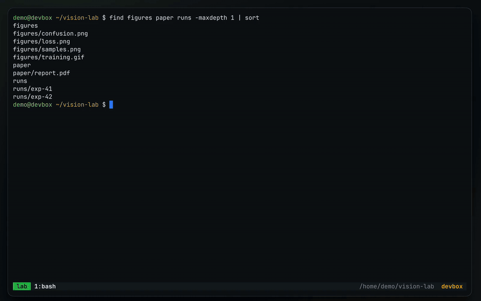

<p align="center">
  
</p>

<h1 align="center">tmux-opener</h1>

<p align="center">
  Open what's in your remote terminal on your laptop.<br>
  <a href="https://tmux-opener.ramlaoui.org/"><b>Documentation</b></a> ·
  <a href="https://tmux-opener.ramlaoui.org/getting-started/installation/">Install</a> ·
  <a href="https://github.com/Ramlaoui/tmux-opener/releases">Releases</a>
</p>

Over SSH, the links, tracebacks and files in your terminal are stuck on the
server. tmux-opener sends them to your laptop: select one in tmux, press a key,
and it opens in your browser, in VS Code at the right line, or lands in your
Downloads folder. Images, GIFs and PDFs can also be previewed right in tmux.

<p align="center">
  
</p>

## Install

On the SSH host, with [TPM](https://github.com/tmux-plugins/tpm), add this to
`~/.tmux.conf` and press <kbd>prefix</kbd> <kbd>I</kbd>:

```tmux
set -g @plugin 'Ramlaoui/tmux-opener'
```

On your laptop, download `tmux-opener-client-vX.Y.Z.tar.gz` from the
[latest release](https://github.com/Ramlaoui/tmux-opener/releases) and run:

```sh
mkdir -p ~/.local/share ~/.local/bin
tar -xzf tmux-opener-client-vX.Y.Z.tar.gz -C ~/.local/share
ln -sf ~/.local/share/tmux-opener-client/bin/tmux-opener ~/.local/bin/
ln -sf ~/.local/share/tmux-opener-client/bin/tmux-opener-client ~/.local/bin/
```

Then connect once with the wrapper. It adds a managed block to
`~/.ssh/config` (after a backup), so a plain `ssh HOST` works from then on:

```sh
tmux-opener ssh HOST
```

Both sides need Python 3.10 or newer and nothing from PyPI. The
[installation guide](https://tmux-opener.ramlaoui.org/getting-started/installation/)
covers release archives and optional extras.

## Keys

| Key | Where | Action |
| --- | --- | --- |
| <kbd>o</kbd> | copy mode | Open a URL, `localhost` port or `path:line` on the laptop |
| <kbd>i</kbd> | copy mode | Preview an image, GIF, PDF, table or folder in tmux |
| <kbd>d</kbd> / <kbd>D</kbd> | copy mode | Download to Downloads / through a save dialog |
| <kbd>prefix</kbd> <kbd>o</kbd> | normal | Pick a URL or path from the pane |
| <kbd>prefix</kbd> <kbd>P</kbd> | normal | Upload laptop files into the pane's directory |
| <kbd>prefix</kbd> <kbd>O</kbd> | normal | Dashboard of transfers, clients and opener rules |

The host only sends small JSON requests over a forwarded Unix socket, never
commands, and the laptop checks each one before acting. See the
[security model](https://tmux-opener.ramlaoui.org/reference/security/).

## Development

```sh
uv run --frozen --group dev pytest
```

Releases are described in [docs/releasing.md](docs/releasing.md).
