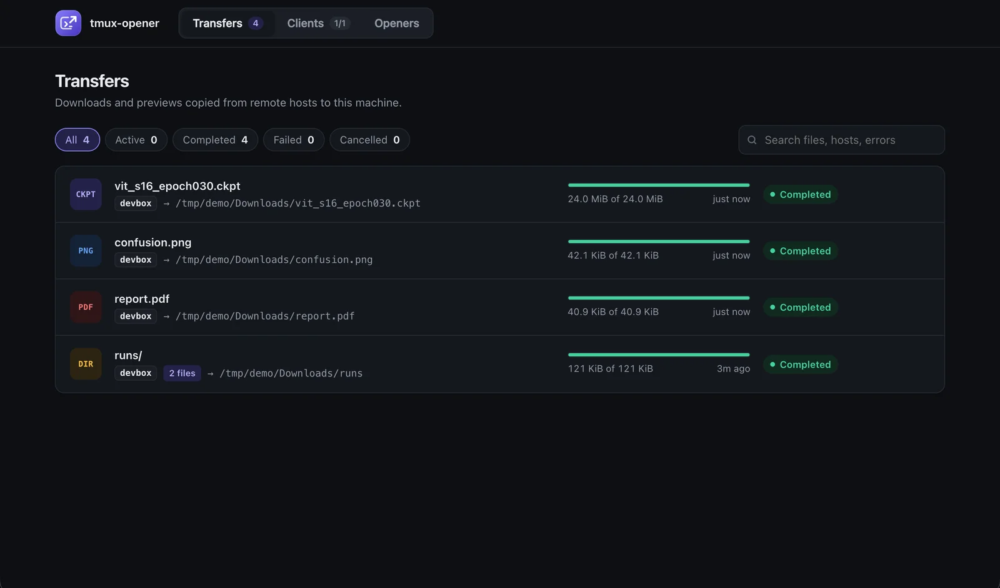
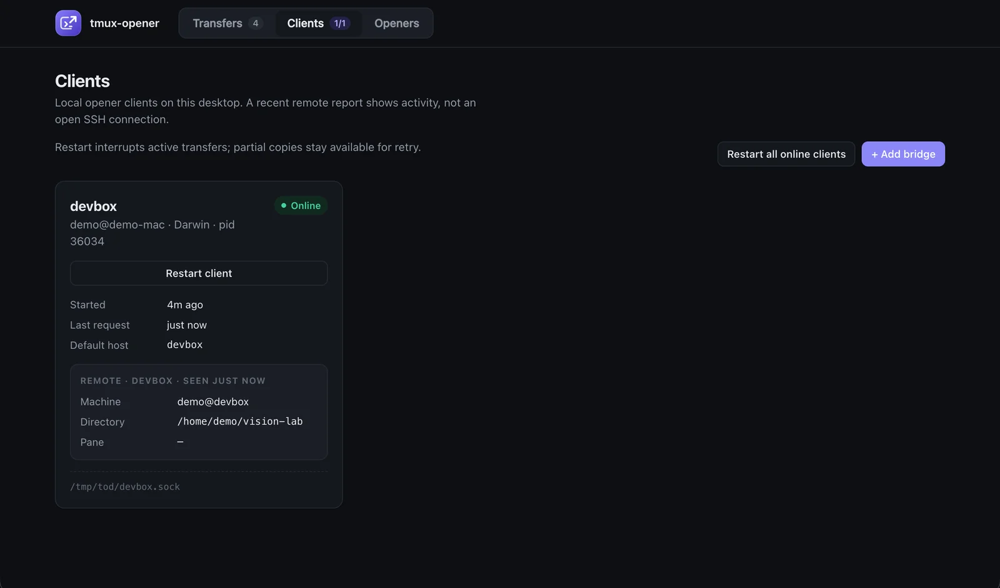
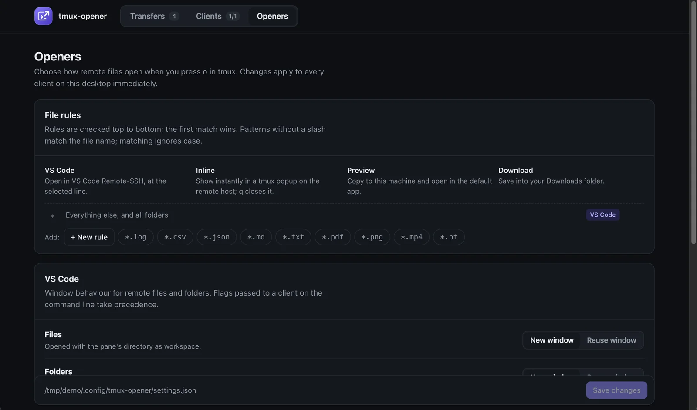

# Dashboards

tmux-opener has three views of the same state: a tmux popup on the host, a terminal dashboard on your laptop, and a browser dashboard on your laptop. Each has **Transfers**, **Clients** and **Openers** pages.

## On the host

Press <kbd>prefix</kbd> <kbd>O</kbd> (capital O) to open the live dashboard in a popup.

<video class="demo" autoplay loop muted playsinline preload="metadata" poster="../../assets/media/dashboard.webp" aria-label="The tmux dashboard shows transfers, clients and opener rules"><source src="../assets/media/dashboard.mp4" type="video/mp4"></video>

| Key | Action |
| --- | --- |
| <kbd>Tab</kbd> | Cycle through Transfers, Clients and Openers |
| <kbd>j</kbd>/<kbd>k</kbd>, arrows | Select a row |
| <kbd>c</kbd> | Cancel the selected transfer |
| <kbd>r</kbd> | Retry a failed, cancelled or interrupted transfer; in Clients, restart the selected client |
| <kbd>R</kbd> | In Clients, restart all online clients shown |
| <kbd>u</kbd> | In Clients, [update the plugin](#update-the-plugin) |
| <kbd>q</kbd> | Close |

The host dashboard reaches only the client behind its forwarded bridge. It shows that client's machine, user, OS and process, the current host and pane, and recent transfers with progress bars.

## In your browser

```sh
tmux-opener dashboard          # every desktop client
tmux-opener dashboard devbox   # one host's client
```



The page runs on a temporary loopback port and is protected by a random token, so other local users and web pages cannot drive it. It polls every client socket on the laptop, including custom sockets in managed SSH snippets, and also lists configured clients that are offline. `--no-browser` prints the URL instead of opening it. Keep the command running while you use the page; <kbd>Ctrl</kbd>+<kbd>C</kbd> stops it.

For the same views in a terminal, run `tmux-opener terminal-dashboard`, or press <kbd>prefix</kbd> <kbd>O</kbd> in local tmux after loading `integration/client.tmux` (see [installation](../getting-started/installation.md#on-your-laptop)).

## Clients



The Clients page shows each desktop client process and its recent host activity, with **Restart client** and **Restart all online clients**. Restarts keep the startup options and native service supervision. Active transfers are interrupted; retry them from Transfers to resume their partial copies.

**Online** means the client answered a status request. Host details are reported by the plugin when you download or open the dashboard, so their timestamp shows recent activity, not a live SSH connection.

## Add a bridge

**Add bridge** on the browser Clients page, or <kbd>a</kbd> in the terminal dashboard's Clients view, lists the concrete `Host` aliases in `~/.ssh/config` (following `Include`, skipping wildcard and negated patterns) and marks those that already have a bridge. Type to filter and pick a host: the dashboard runs `tmux-opener install-host --start-client HOST`, and you connect with a plain `ssh HOST`.

An existing, conflicting `RemoteForward` is reported rather than overwritten. Pass `--ssh-config PATH` to list another config. The host dashboard cannot add bridges, because a forwarded session must not edit your laptop's SSH config.

## Update the plugin

**Update plugin** on a browser client card, or <kbd>u</kbd> in a terminal dashboard's Clients view, updates the Remote Opener Plugin the way TPM does: it fast-forwards the plugin's git checkout to its tracked branch (usually `main`) and reloads its tmux bindings.

The laptop dashboards update the selected host by piping `scripts/tmux-opener-update` over the same batch-mode SSH that downloads use, so the host must accept key or agent authentication. The host dashboard updates its own host. The update refuses release-archive installs and checkouts whose local changes would be overwritten, and reports the old and new commits. Restart the laptop client separately when its install changes too.

## Openers

The Openers page edits the desktop's [opener rules](opener-rules.md), VS Code window policies, PDF viewer and download notifications.


